# NC3 — Findings by Metric

**Lansing Economic Ecosystem and Community Wealth Analysis**  
Prepared for the Lansing Growth Fund | November 2026

This document summarizes the public-data baseline developed for the Lansing Growth Fund. It estimates the local economic footprint of the Big 4 institutions—Michigan State University, General Motors, State Government, and Local/Regional Governments—on employment, the tax base, and community wealth retention in the Lansing–East Lansing region (Ingham, Eaton, and Clinton counties).

Employment is reported as ranges because of QCEW single-employer suppression. MSU is contained within state-government totals and is not double-counted.

---

## 1. Big 4 Employment Ranges

Approximate 2025 employment bounds for the Greater Lansing region (total jobs approximately 220,000). The ranges are constructed from ACFR principal-employer rankings and QCEW ownership and industry totals. These bounds provide a practical, annually refreshable measure of institutional scale when plant-level or employer-level cells are suppressed.

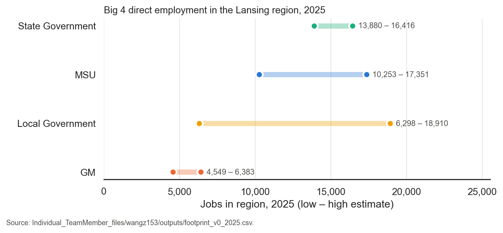

*Figure 1. Big 4 employment ranges (2025).*

---

## 2. Employment by Ownership

QCEW ownership composition for the MSA shows the relative size of private, state government, local government, and federal employment. State government (which includes public universities such as MSU) and local government together form a substantial share of total regional employment alongside the private sector. This composition is a core context indicator for the scorecard.

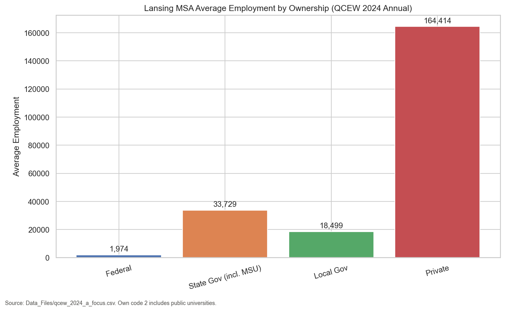

*Figure 2. MSA employment by ownership (QCEW).*

---

## 3. Labor Market (LAUS Unemployment)

The Lansing–East Lansing MSA unemployment rate recovered from the sharp 2020 spike and has remained in the mid-to-high 4 percent range in recent years. This series provides the broader labor-market context against which institutional employment contributions can be interpreted.

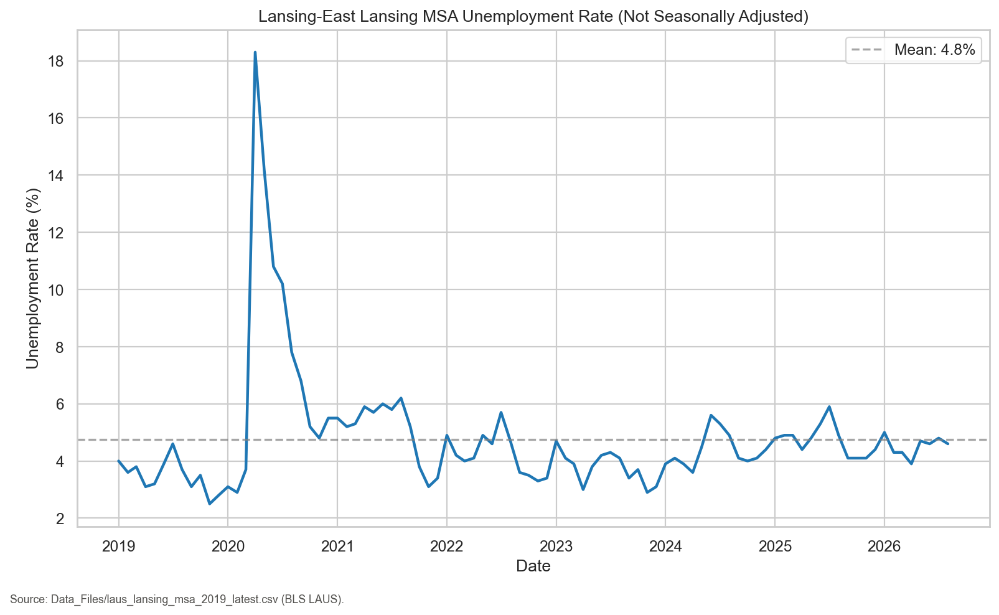

*Figure 3. Lansing–East Lansing MSA unemployment rate (LAUS).*

---

## 4. GM Regional Employment

General Motors remains the fourth-largest regional employer. Employment declined from 5,222 in 2016 to 4,549 in 2025, a reduction of approximately 13 percent. The broader metro employment base also declined over the same period, so GM’s relative share of metro employment fell only modestly (from 2.28 percent to 2.15 percent).

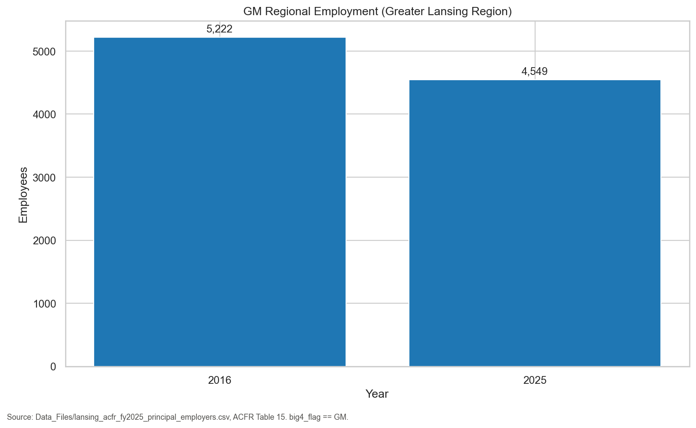

*Figure 4. GM regional employment (ACFR principal employers).*

---

## 5. GM Taxable Value

Combined City of Lansing taxable assessed value for GM entities rose in absolute terms from approximately $59.3 million in 2016 (rank 1) to roughly $69.0 million in 2025 (split across ranks 3 and 9). While absolute value increased, relative ranking declined. Ultium Cells / LG Energy Solution is tracked separately and excluded from pure GM totals. Manufacturing personal property is largely exempt, so the series primarily reflects real property and Industrial Facilities Tax parcels.

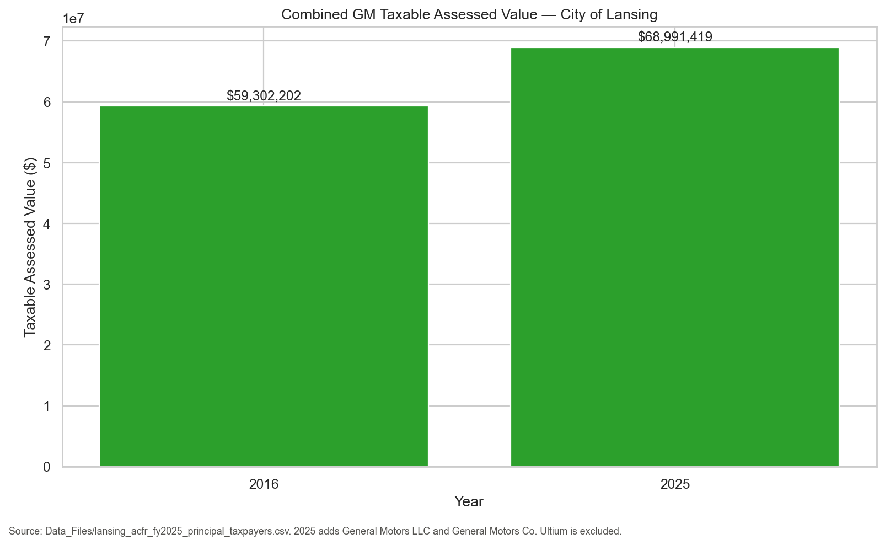

*Figure 5. Combined GM City of Lansing taxable value.*

The core real-property parcel for the Lansing Delta Township Assembly (8001 Davis Highway) shows steady taxable-value growth of approximately 11 percent from 2023 to 2026. PA 425 agreements mean some Eaton County assembly activity is taxed through the City of Lansing.

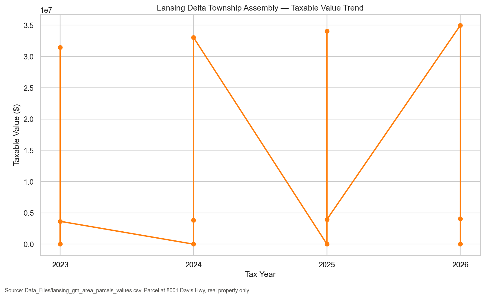

*Figure 6. Lansing Delta Township Assembly taxable value trend.*

---

## 6. Median Household Income by County

ACS 2020–2024 five-year estimates show Clinton County with the highest median household income, followed by Eaton County, then Ingham County. Ingham’s lower median income coexists with the region’s largest state-government employment share, illustrating that a large public institutional footprint does not automatically produce higher resident median incomes.

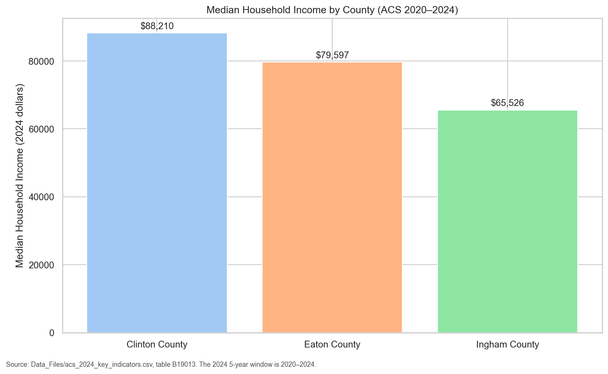

*Figure 7. Median household income by county (ACS 2020–2024).*

---

## 7. City–County–MSA Income Contrast

Lansing city (approximately $54,400) and East Lansing city (approximately $45,700) show substantially lower median household incomes than their respective counties and the MSA. Poverty rates are correspondingly higher. East Lansing figures are influenced by student populations, which depress median income and elevate poverty rates independent of institutional job access.

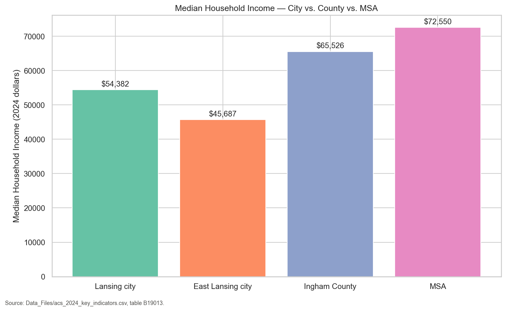

*Figure 8. City versus county versus MSA median household income.*

---

## 8. State Government Share versus Income

A directional pattern appears across the three counties: the county with the highest state-government employment share (Ingham) has lower median household income than Eaton or Clinton. With only three observations these correlations are descriptive only and should not be treated as precise coefficients.

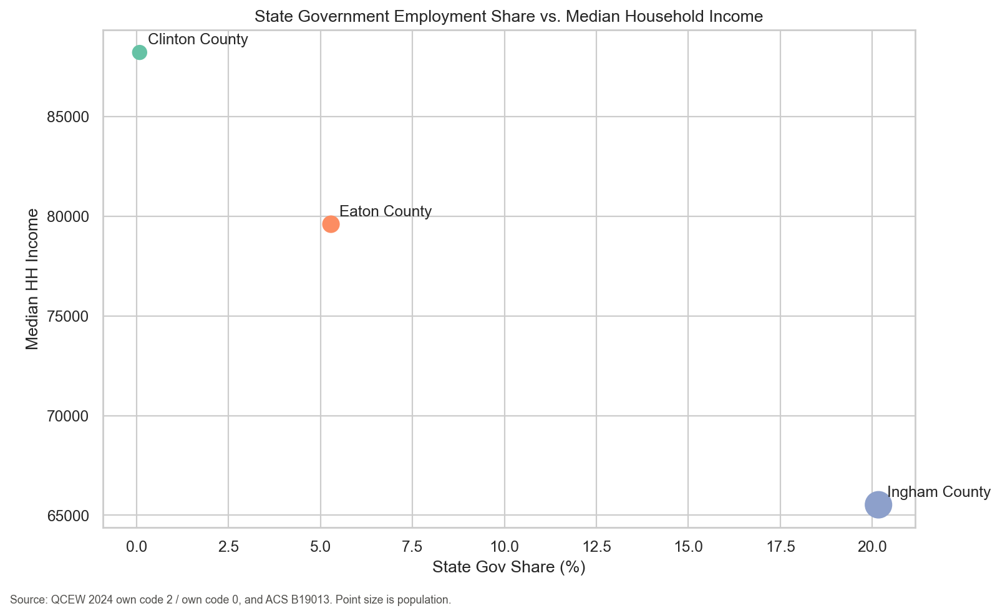

*Figure 9. State-government employment share versus median household income.*

---

## 9. Manufacturing (NAICS 336) Share versus Poverty

Eaton County has the strongest concentration of NAICS 336 (transportation equipment manufacturing) employment and stronger county-level poverty outcomes relative to Ingham. In this small sample, manufacturing employment share aligns more closely with better resident outcomes than state-government share. QCEW plant-level cells for GM facilities are typically suppressed, so industry totals serve as the reliable public bound.

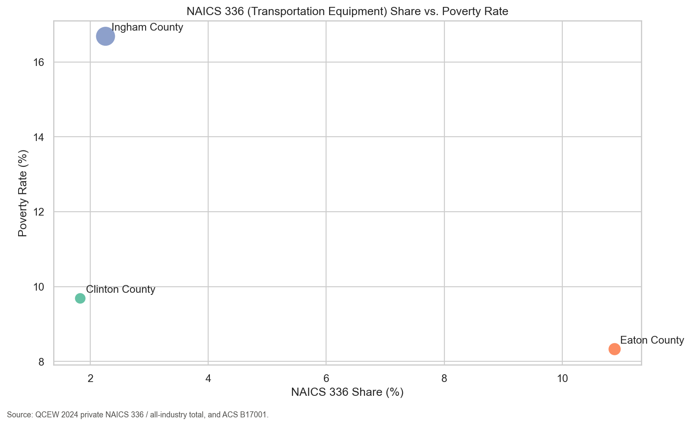

*Figure 10. NAICS 336 employment share versus poverty rate.*

---

## 10. Tract-Level Poverty

The highest-poverty tracts in the tri-county region cluster in Ingham County, particularly in the Lansing and East Lansing areas. Several of these tracts also show low owner-occupancy rates, consistent with rental and student housing patterns. This ranking provides a starting point for neighborhood mismatch analysis.

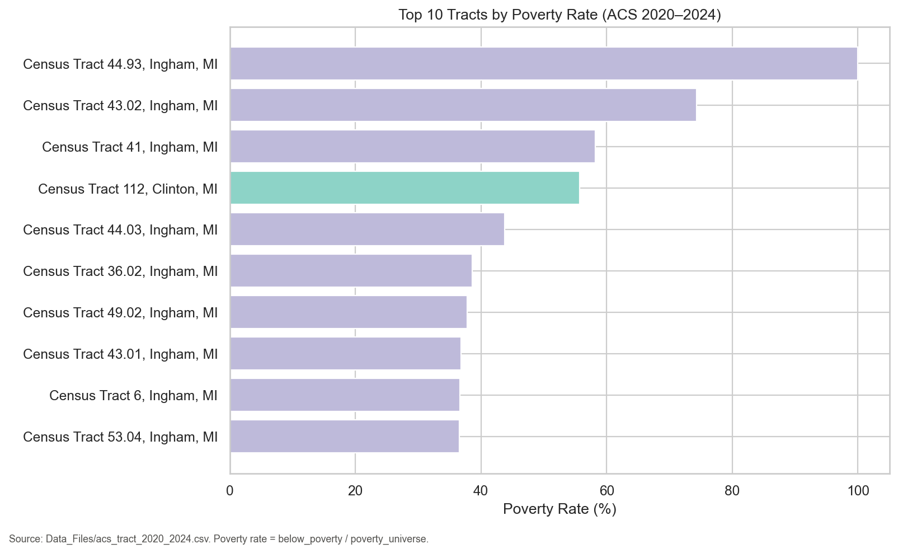

*Figure 11. Highest-poverty tracts (ACS 2020–2024).*

---

## 11. Lowest-Income Tracts

The lowest median-income tracts are also concentrated in Ingham County. Together with the poverty rankings, these tracts reinforce the geographic mismatch between institutional presence (MSU campus, state agencies, GM sites) and resident-level economic outcomes. Overlaying tract centroids with institutional site locations remains a recommended next step.

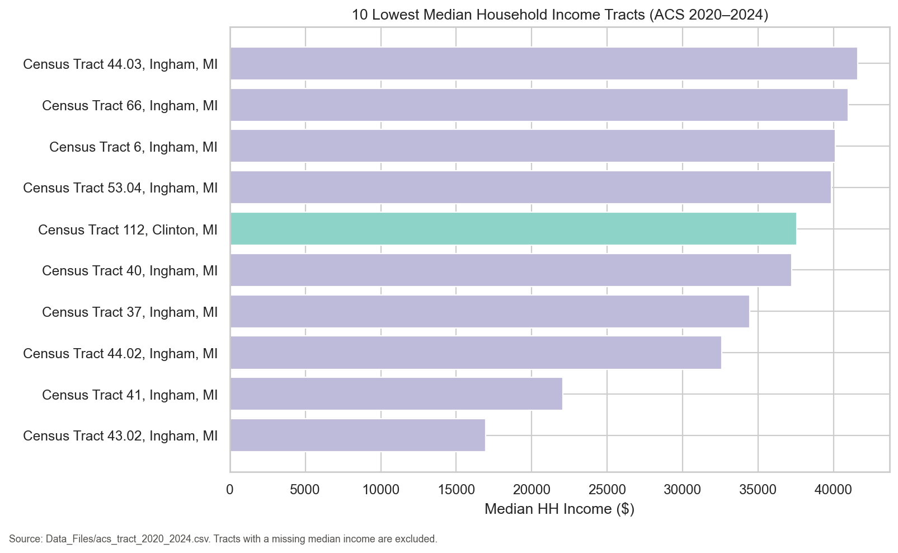

*Figure 12. Lowest median household income tracts (ACS 2020–2024).*

---

## 12. Local and Regional Commuting Capture

ACS commuting data indicate that approximately 85 percent of workers whose jobs are located in the tri-county region also reside in the region. Same-county residence rates are lower, ranging from roughly 51 percent to 64 percent depending on the county. LODES administrative origin-destination data produce lower regional capture rates (approximately 55–61 percent after adjustments). Both sources are reported as bounds rather than a single capture rate because they measure residence differently.

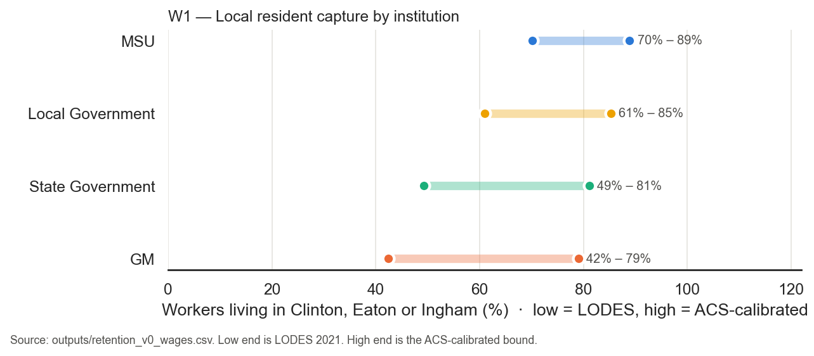

*Figure 13. Local and regional commuting capture (ACS and LODES).*

---

## Notes and Next Steps

All figures are reproducible from the project repository using the documented notebooks and source extracts. Key caveats include:

- QCEW single-employer suppression requires range reporting.
- ACS (residence-based) and QCEW (workplace) measure different concepts.
- City ACS figures for East Lansing are influenced by student populations.
- Most manufacturing personal property is exempt; taxable-value series primarily reflect real property and IFT parcels.
- Three-county correlations are directional only.

**Priority data gaps** for future collection:

1. Institutional local procurement and purchasing
2. More granular job-flow and graduate retention data (QWI and PSEO)
3. Opportunity Atlas mobility measures joined to tract GEOIDs
4. HUD CHAS housing affordability detail
5. Federal awards footprint from USAspending.gov

These additions would strengthen the annual scorecard’s decision value for the Lansing Growth Fund.

---

*All underlying extracts, notebooks, and figure-reproduction instructions are maintained in this repository for continued use and annual update.*
